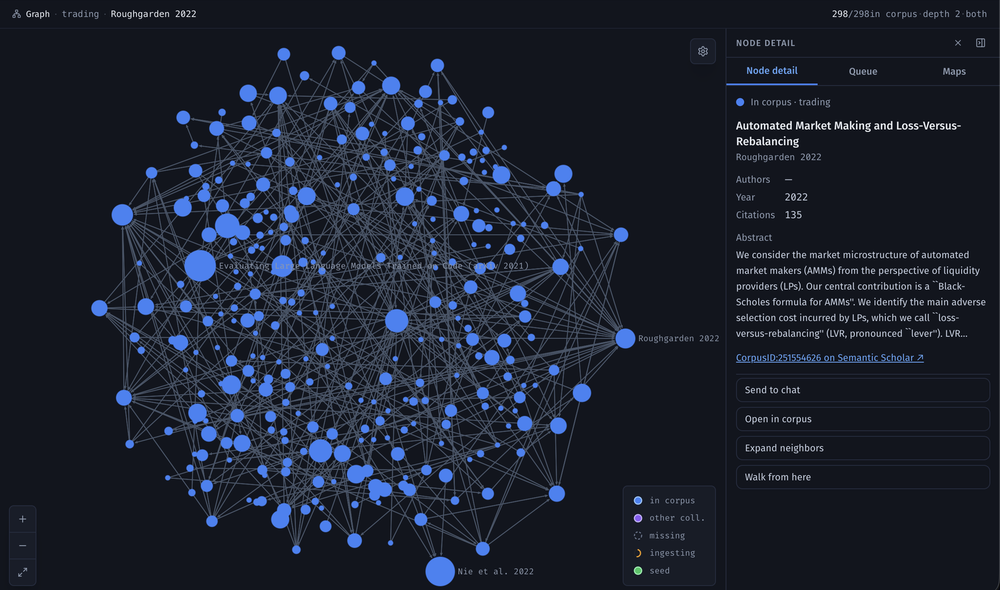
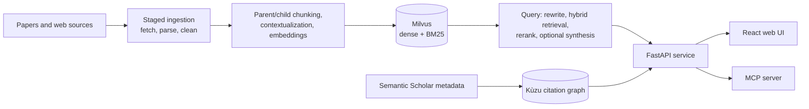

<div align="center">

# Research RAG System

**Ask questions over a private paper collection and get answers with source references, then explore what each paper cites and who cites it.**

[](https://github.com/jmenzler/research-rag-system/actions/workflows/ci.yml)


[Overview](#overview) · [Features](#features) · [Architecture](#architecture) · [Design decisions](#design-decisions) · [Local checks](#local-checks)

</div>

A FastAPI service backs a React web UI, and an MCP server gives AI agents the same tools.

## Overview

Research questions are poorly served by plain vector search: terminology varies between papers, long documents lose context when chunked, and an answer without a traceable source is not usable. This system ingests papers and web sources, retrieves with dense and BM25 evidence, reranks, and returns the source chunks or a referenced LLM answer. Separately, it traverses a Semantic Scholar citation graph (34M papers, 626M edges in the author's local build) to surface related and obscure-but-relevant work.

> [!NOTE]
> This public snapshot is source only. It excludes the research corpus, citation datasets, private deployment configuration, credentials and the GPU broker integration. There is no hosted demo, and tests use synthetic inputs and mocked services, so they do not establish retrieval quality on a real corpus.

## Features

- **Hybrid retrieval.** Dense and BM25 search in Milvus, fused with reciprocal rank fusion, then cross-encoder reranking.
- **Query decomposition.** Complex questions split into sub-queries whose result lists are merged before reranking, with optional MMR for diverse evidence.
- **Parent/child chunks.** Small chunks are embedded for matching; the larger parent text is returned for context.
- **Query audits.** Each query records the retrieval path taken, token usage and estimated provider cost.
- **Citation graph explorer.** Walks references, citers, co-citation and bibliographic coupling in a Kùzu graph, ranked with a recency factor and a bias toward less-cited papers.
- **Agent access.** An MCP server forwards retrieval, discovery and ingestion tools to the same API.
- **Persistent work queues.** Discovery and ingestion survive restarts, with progress streaming to the UI.



## Architecture



- **Ingestion** (`src/pipeline/`, `src/ingest/`) runs documents through staged fetch, parse and cleanup steps, splits them into parent and child chunks, and embeds the children. Child embeddings and retrieval fields go to Milvus; parent text and app state stay in local SQLite.
- **Query** (`src/query/`) rewrites the question, combines dense and BM25 evidence, reranks candidates, and either returns the source chunks or passes them to an LLM for a referenced answer.
- **Serving** (`src/server/`) is a FastAPI app with persistent work queues, chat storage and streaming. The React UI (`frontend/src/`) calls it directly, and the MCP server (`src/mcp_server.py`) forwards agent tool calls to the same API rather than owning a corpus.
- **Citations** (`src/citations/`) import Semantic Scholar paper metadata into a Kùzu graph that the UI explores with Sigma.js.

See [docs/architecture.md](docs/architecture.md) for component boundaries and external dependencies.

## Design decisions

- **One service, many clients.** The MCP server owns no corpus and forwards to the HTTP API, so agents and the browser see identical behaviour and audits.
- **Audit what actually ran.** Optional retrievers are flag-gated and the audit records the path taken, so evaluation reflects the real pipeline instead of a configured ideal.
- **Graph queries shaped for the engine.** Kùzu 0.11.3 uses its primary-key index only for literal equality, so walks issue one literal query per frontier node (`src/citations/_kuzu_query.py`). In the author's local build this cut the buffer pool from 24 GB to 4 GB.
- **Missing infrastructure fails loudly.** Optional GPU parsers and rerankers raise explicit errors when their integrations are absent.

## Inspect the implementation

- [Setup and testing](docs/setup-and-testing.md): credential-free checks and external runtime requirements.
- [Security and data boundaries](docs/security-and-data-boundaries.md): local-only use, provider access, and excluded data.

Tests use synthetic inputs and mocked external services. Passing those tests does not establish retrieval quality on a real corpus or validate live provider integrations.

## Local checks

Use Python 3.11, uv, and Node.js 22.12 or newer. Run from a source checkout:

```sh
uv sync --frozen --python 3.11 --extra dev
uv run ruff check .
uv run mypy src
uv run pytest -m 'not slow and not e2e' -q
cd frontend
npm ci
npm test -- --run
npm run build
```

These checks need package downloads but no provider credentials, database server, downloaded model weights, or GPU. Running the application against documents does require external services and user-supplied data. There is no hosted demo or bundled research corpus.

## Snapshot and rights

This is a manually curated source snapshot with an independent Git history, not an automatic mirror. Private deployment configuration, research data, credentials, internal planning, and operational history are excluded. Updates are reviewed and released manually.

Source is publicly viewable for portfolio review. No license is granted for reuse.

Third-party portions retain their own terms; see [Third-party notices](THIRD_PARTY_NOTICES.md). Dependency packages and model weights are distributed separately under their respective licenses.
